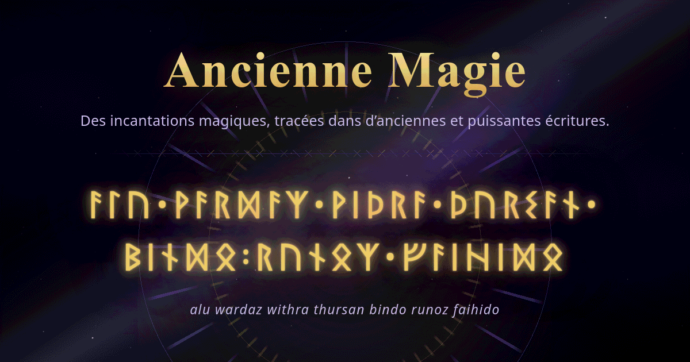

# Ancienne Magie 🔮

[](https://ancientmagic.iglou.eu/fr.html)
[](https://unlicense.org/)
[](#)



> Des incantations magiques, tracées dans d’anciennes et puissantes écritures.

Un autel incantatoire, au centre de l’infini étoilé de la nuit et personne pour vous entendre. La langue, l’école et la puissance, donneront naissance à une insondable puissance.

Ce qui apparaîtra, le sera pour vous seul et nul n’a jamais osé le prononcer. Les écritures, elles, l’ont été. Comme les runes qui ont mordu la pierre, les hiéroglyphes couvert des parois, le phénicien courut sur des jarres. Ancienne Magie leur emprunte signes et puissance, emerge une grammaire, puis, du tréfonds de cet autel de pierre en sort une formule, translittérée, traduite jusqu’à la glose.

Je préfère vous avertir, ces anciennes écritures ne sont pas toujours bien comprises, je ne peux vous promettre une traduction fiable ou un enseignement et ... Si malgré toutes vos précautions, quelque chose répond, je vous aurai prévenus !

## ⚗️ Faire tourner l’atelier

Trois dépendances de développement, aucune à l’exécution. Sass compile la
feuille, TypeScript compile le script, terser le resserre, un générateur écrit
une page par langue. Le dossier `pub/` est le site, servi tel quel.

```bash
npm install
npm run build   # sass, tsc, terser, génération des pages, le tout vers pub/
npm test        # tests, node:test seul, aucune dépendance de test
```

Pour voir le résultat, n’importe quel serveur statique posé sur `pub/`.
Ou bien la stèle qui dans l’ombre attend [ancientmagic.iglou.eu/fr.html](https://ancientmagic.iglou.eu/fr.html)

## 🕯️ La licence

Ce projet est dans le [domaine public, sous Unlicense](https://unlicense.org/).
Aucune permission à demander, aucune attribution à porter, aucune condition à
lire.

La plus grande part de ce code a été écrite par une intelligence artificielle.
Et cette intelligence, elle, a été bâtie sur le bien commun, des milliards de
lignes, de pages et de gestes déposés par d’autres avant nous, le plus souvent
sans qu’ils sachent qu’ils nourrissaient une machine. Ce qui sort de là n’a pas
à s’arrêter en chemin. Ça retourne d’où ça vient.

En plus Ancienne Magie ne sert qu’à rêver !
