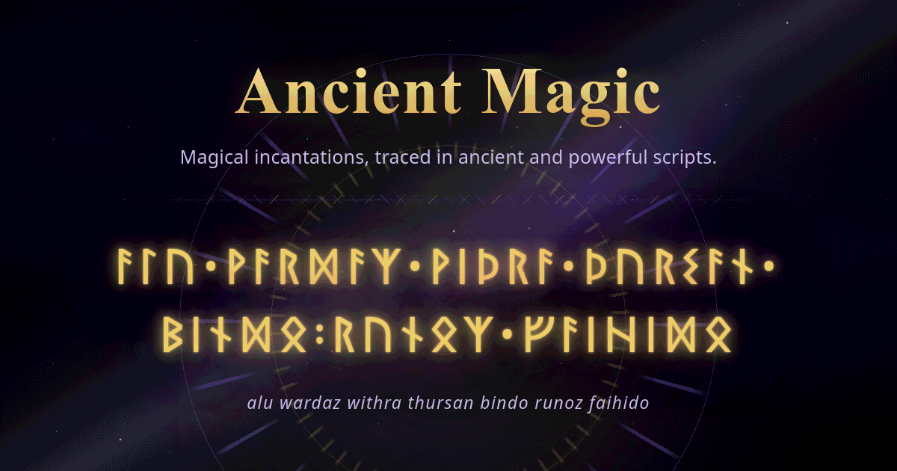

# Ancient Magic 🔮

[](https://ancientmagic.iglou.eu/)
[](https://unlicense.org/)
[](#)



> Magical incantations, traced in ancient and powerful scripts.

An incantatory altar, at the heart of the night’s starred infinity, and no one to hear you. The language, the school and the power will give birth to an unfathomable power.

What appears will appear for you alone, and none has ever dared to speak it. The scripts, for their part, have been spoken. Like the runes that bit into the stone, the hieroglyphs spread across the walls, the Phoenician running along the jars. Ancient Magic borrows their signs and their power, draws out a grammar, then, from the uttermost depths of this stone altar, draws up a formula, transliterated, translated down to the gloss.

But I had better warn you, these ancient scripts are not always well understood, I cannot promise you a reliable translation or a teaching, and ... If, despite all your precautions, something answers, don’t say I didn’t warn you!

## ⚗️ Running the workshop

Three development dependencies, none at runtime. Sass compiles the
stylesheet, TypeScript compiles the script, terser tightens it, a generator
writes one page per language. The `pub/` folder is the site, served as is.

```bash
npm install
npm run build   # sass, tsc, terser, page generation, all into pub/
npm test        # tests, node:test alone, no test dependency
```

To see the result, any static server sitting on `pub/`.
Or the stele that waits in the shadow, [ancientmagic.iglou.eu](https://ancientmagic.iglou.eu/)

## 🕯️ The license

This project is in the [public domain, under the Unlicense](https://unlicense.org/).
No permission to ask, no attribution to carry, no terms to read.

Most of this code was written by an artificial intelligence. And that
intelligence was itself built upon the commons, billions of lines, of pages
and of gestures laid down by others before us, most often without their
knowing that they were feeding a machine. What comes out of it has no
business stopping along the way. It goes back where it came from.

Besides, Ancient Magic is only good for dreaming!
